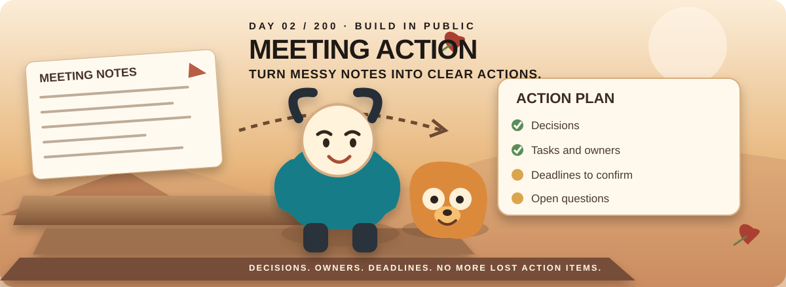
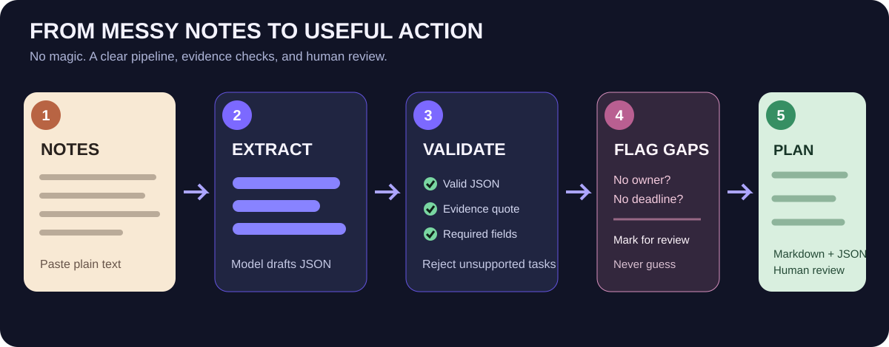
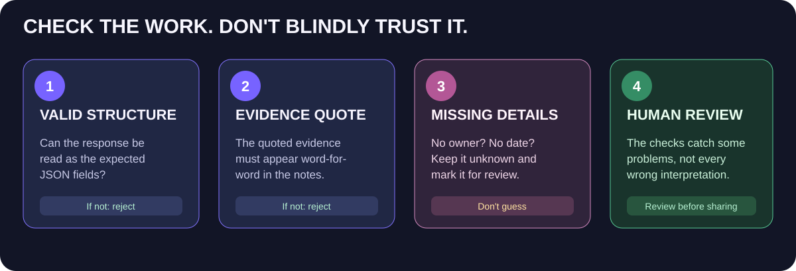

# Meeting Action Agent

**Day 02 of the 200 AI Agents in 200 Days challenge**

Turn chaotic meeting notes into a useful action plan: what was decided, what needs doing, who owns it, what the deadline is, and what still needs clarification.

**The important rule:** if the notes do not name an owner or deadline, the agent leaves it unknown. It should not invent details to make the output look complete.

[Download full project ZIP](https://github.com/yerageracharan/meeting-action-agent/archive/refs/heads/main.zip) · [Download visual setup PDF](docs/Local-AI-and-API-Setup-Guide.pdf) · [Read setup guide](docs/Local-AI-and-API-Setup-Guide.md)

[Quick start](#quick-start) · [How it works](#how-it-works) · [Choose your model](#choose-how-the-ai-runs) · [Troubleshooting](#troubleshooting)

---

## What does it do?

Imagine you finish a meeting with notes like these:

    Priya will send the landing-page copy to Marcus by Thursday.
    We talked about a customer FAQ, but nobody owns it yet.
    Alex will send the event-name list by Friday.
    The legal review might take longer than planned.

The agent turns those notes into a structured report containing:

- **Summary** — what the meeting was about.
- **Decisions** — what people explicitly agreed.
- **Action items** — the work that needs doing.
- **Owners and deadlines** — only when the notes actually state them.
- **Evidence quotes** — the exact text from the notes used to support an action.
- **Open questions** — things the team still needs to answer.
- **Risks and blockers** — possible issues that might delay progress.
- **Markdown and JSON output** — one report for people and one structured file for other software.

## Why this is an AI agent

It does more than send one prompt to a chatbot. It accepts notes, calls a configured language model, asks for structured data, validates the response, rejects unsupported action items when their evidence quote is not present in the notes, and writes a report. A human should still review the result before treating it as a final record.

## Quick start

You need Python 3.10 or newer. The project can use a local model through LM Studio or Ollama, or a hosted model provider that exposes an OpenAI-compatible Chat Completions API.

### 1. Open the project folder

Download or clone this repository, extract it if needed, and open PowerShell in the folder containing pyproject.toml.

### 2. Create a virtual environment

Windows PowerShell:

    python -m venv .venv
    .\.venv\Scripts\Activate.ps1

macOS or Linux:

    python3 -m venv .venv
    source .venv/bin/activate

### 3. Install the project

    python -m pip install --upgrade pip
    python -m pip install -e ".[test]"

To install the optional web interface too:

    python -m pip install -e ".[test,ui]"

### 4. Start a model

Choose one of the following routes. You do not need a paid API key to use a local model after you have downloaded the model and started its server.

#### Option A — LM Studio on your own computer

1. Download and install LM Studio from https://lmstudio.ai/.
2. Open Discover and select a model small enough for your computer.
3. Download it, then load it in the Chat screen.
4. Open the Developer tab and start the local server.
5. The default server URL is commonly http://localhost:1234/v1. Use the address shown in your version of LM Studio.
6. Set the model connection in PowerShell:

    $env:MEETAGENT_BASE_URL = "http://localhost:1234/v1"
    $env:MEETAGENT_MODEL = "YOUR-EXACT-LOADED-MODEL-ID"
    Remove-Item Env:MEETAGENT_API_KEY -ErrorAction SilentlyContinue

To list the model IDs exposed by the running server:

    Invoke-RestMethod http://localhost:1234/v1/models | ConvertTo-Json -Depth 5

Copy the exact model ID into MEETAGENT_MODEL. Keep the /v1 suffix in the base URL; do not add /chat/completions yourself.

Official docs: [download a model](https://lmstudio.ai/docs/app/basics/download-model) · [start the local server](https://lmstudio.ai/docs/developer/core/server) · [authentication](https://lmstudio.ai/docs/developer/core/authentication).

#### Option B — Ollama on your own computer

1. Install Ollama from https://ollama.com/download.
2. In PowerShell, download a small starter model:

    ollama pull qwen2.5:3b

3. Set the agent connection:

    $env:MEETAGENT_BASE_URL = "http://localhost:11434/v1"
    $env:MEETAGENT_MODEL = "qwen2.5:3b"
    Remove-Item Env:MEETAGENT_API_KEY -ErrorAction SilentlyContinue

The model name must match the model you downloaded. See the [Ollama documentation](https://docs.ollama.com/).

#### Option C — Hosted API

A hosted provider runs the model on its own servers. You generally need internet access, an API key, and possibly paid usage. For the OpenAI API, manage keys at https://platform.openai.com/api-keys and use the current official API documentation for available models and prices.

Set the environment variables in PowerShell:

    $env:MEETAGENT_BASE_URL = "https://api.openai.com/v1"
    $env:MEETAGENT_MODEL = "YOUR-PROVIDER-SUPPORTED-MODEL-ID"
    $env:MEETAGENT_API_KEY = "YOUR-SECRET-API-KEY"

Never put a real API key into source code, README files, screenshots, or Git commits. The ChatGPT subscription and API billing are separate.

### 5. Generate your first action plan

Run the included example:

    meetagent examples/meeting_notes.txt --out output/action_plan.md

If Windows cannot find the meetagent command, use:

    python -m meetagent.cli examples/meeting_notes.txt --out output/action_plan.md

The agent writes a Markdown report at output/action_plan.md and JSON data at output/action_plan.json. Exact results depend on the model you use, and the generated report should be checked by a person.

To analyze your own notes, save them as a UTF-8 text file and pass its path:

    meetagent "notes/my-meeting.txt" --out "output/my-action-plan.md"

### 6. Optional browser interface

Install the UI extra if you have not already:

    python -m pip install -e ".[ui]"

Then start the app:

    streamlit run app.py

Open the local address Streamlit prints, paste your notes, and select Create action plan. You can download the resulting Markdown report.

## How it works

1. **Read:** the program reads the meeting notes.
2. **Extract:** the configured model is asked to return a JSON object with a fixed structure.
3. **Validate:** the program checks that the response is valid JSON and has the expected fields.
4. **Check evidence:** every action item must include a quote that appears exactly in the original notes. Unsupported action items are rejected.
5. **Flag missing information:** an item without an owner or due date is marked as needing clarification.
6. **Save:** a human-readable Markdown report and structured JSON are written to disk.

These checks reduce some common errors. They do not prove that every decision or summary is semantically correct; review the notes and output before relying on it.

## Pick a model that fits your computer

These are rough starting points, not guarantees. Model size, quantization, context length, GPU memory, and other open applications all affect performance. Start with a small instruct model and increase size only if your computer handles it comfortably. Check the current [LM Studio system requirements](https://lmstudio.ai/docs/app/system-requirements).

The longer beginner guide is here: [Local AI and API Setup Guide](docs/Local-AI-and-API-Setup-Guide.md). It explains how to check RAM and GPU memory, download a model, start LM Studio's local server, find a model ID, use an optional local-server token, and set up a hosted provider key.

## Run the tests

    python -m pytest -q

The repository includes tests for supported output, missing owners/deadlines, evidence checks, report rendering, and empty input. Automated tests use mocked model responses; they do not prove every real model behaves reliably.

## Project layout

    app.py                       Optional Streamlit browser UI
    meetagent/
      agent.py                   Prompting, JSON validation, evidence check
      provider.py                OpenAI-compatible local/hosted API caller
      cli.py                     Command-line interface
      render.py                  Markdown and JSON report output
    examples/
      meeting_notes.txt          Sample meeting notes
    tests/
      test_agent.py              Automated tests
    assets/
      hero.svg                   Project cover visual
      workflow.svg               Notes-to-action workflow
      model-routes.svg            Local versus hosted model guide
      guardrails.svg              Evidence and validation visual
      hardware-picker.svg         Rough hardware selection guide
    docs/
      Local-AI-and-API-Setup-Guide.md
                                 Detailed beginner setup guide
    pyproject.toml                Install and package configuration
    .env.example                  Example environment settings

## Troubleshooting

**Could not reach the model server:** start the model in LM Studio or make sure Ollama is running. Check MEETAGENT_BASE_URL and confirm that the server endpoint matches the selected tool.

**The model returned invalid JSON:** try a stronger instruction-following model, shorten the notes, or run the same input again. Models vary in how consistently they follow structured-output instructions.

**An action item is rejected because the quote is missing:** the program requires evidence to be copied exactly from the notes. That is deliberate; review the notes and try again.

**The action plan has no owner or deadline:** this is expected if the notes did not provide them. The agent should not guess.

**The API returns an authentication or billing error:** verify the provider's key, model ID, endpoint and account usage settings. Keep secrets out of the repository.

## Limitations

- Model output can still be incomplete or wrong; human review is required.
- Exact quote matching is a lightweight grounding check, not a complete truth detector.
- A model may confuse a suggestion with a confirmed decision despite the prompt instructions.
- This version processes plain-text meeting notes. It does not transcribe audio or join meetings automatically.
- No calendar updates, email sending, or task creation in external project-management software are performed.
- Hosted APIs may send meeting content to a third-party provider. Check your organisation's privacy requirements before using sensitive notes.

## License

MIT. See [LICENSE](LICENSE).

---

**Day 02 / 200.** One agent at a time. Build it, test it, document it, improve it.
