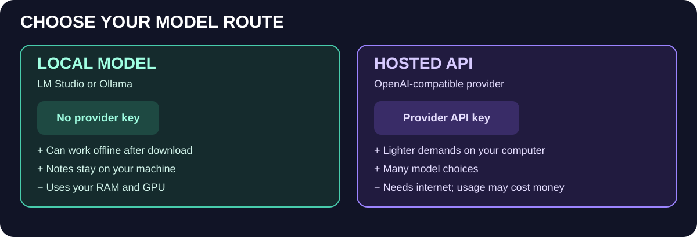
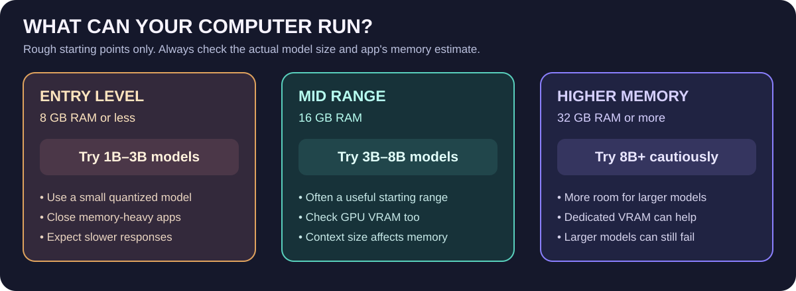
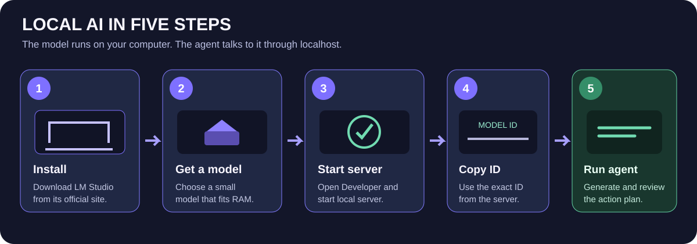

# Local AI and API Setup Guide

This guide explains how to connect Meeting Action Agent to a model. You have two main choices: run a model on your own computer, or send requests to a hosted model provider.

## Choose a route

| Route | Provider API key? | Internet needed while using it? | Trade-off |
|---|---|---|---|
| LM Studio local | No, unless you enable local-server authentication | Usually no after model download | Uses your computer's RAM/GPU and storage |
| Ollama local | No for normal local use | Usually no after model download | Uses your computer's RAM/GPU and storage |
| Hosted API | Usually yes | Yes | Easier on local hardware; may cost money and sends notes to provider |

A local-server token in LM Studio is not the same thing as a paid hosted-provider API key. Local server authentication is optional in typical setups.

## Step 1: check your computer

On Windows, press Ctrl+Shift+Esc to open Task Manager, then select Performance. Note the installed memory (RAM), GPU name and dedicated GPU memory, and free disk space. These are the main clues for choosing a model.

Use the requirements and model size shown by your model app as the final authority. RAM and VRAM requirements depend on model size, quantization, context length, and what else is running. If unsure, start with a smaller instruction-following model.

## Step 2: install LM Studio

1. Open https://lmstudio.ai/ in your browser.
2. Download the Windows installer and install the app.
3. Open LM Studio.
4. Go to Discover and search for a small instruction-following model.
5. Check the displayed download size and quantization. A 4-bit/Q4 version is often a practical starting point.
6. Download the model and wait for it to finish.
7. Load the model in the Chat screen and test with a simple instruction.

Official guide: https://lmstudio.ai/docs/app/basics/download-model

## Step 3: start the local server

1. Open the Developer tab.
2. Start the local server.
3. Use the local URL displayed by LM Studio. It is commonly http://localhost:1234/v1.
4. Keep LM Studio open while you use Meeting Action Agent.

Official guide: https://lmstudio.ai/docs/developer/core/server

## Step 4: connect the project

Open PowerShell in the folder containing pyproject.toml. Activate your Python virtual environment if you created one. Then set the model connection variables for this PowerShell session:

    $env:MEETAGENT_BASE_URL = "http://localhost:1234/v1"
    $env:MEETAGENT_MODEL = "YOUR-EXACT-LOADED-MODEL-ID"
    Remove-Item Env:MEETAGENT_API_KEY -ErrorAction SilentlyContinue

Find available models:

    Invoke-RestMethod http://localhost:1234/v1/models | ConvertTo-Json -Depth 5

Copy the exact model ID into MEETAGENT_MODEL. The base URL should end in /v1; the application adds /chat/completions itself.

## Optional local-server authentication token

If you turn on authentication in LM Studio's local server settings, create or copy the local token shown by that app and set it as MEETAGENT_API_KEY:

    $env:MEETAGENT_API_KEY = "YOUR-LOCAL-SERVER-TOKEN"

This token is only for authenticating to the local server. Do not confuse it with a hosted API provider key. See https://lmstudio.ai/docs/developer/core/authentication.

## Alternative: connect Ollama

1. Install Ollama from https://ollama.com/download.
2. Run:

    ollama pull qwen2.5:3b

3. Point the agent at Ollama's OpenAI-compatible API:

    $env:MEETAGENT_BASE_URL = "http://localhost:11434/v1"
    $env:MEETAGENT_MODEL = "qwen2.5:3b"
    Remove-Item Env:MEETAGENT_API_KEY -ErrorAction SilentlyContinue

Keep Ollama running while you use the project.

## Alternative: use a hosted API

Use a provider that supports OpenAI-compatible Chat Completions. For OpenAI, official key management is at https://platform.openai.com/api-keys. Verify the current model ID, base URL, pricing, and usage limits directly with your provider.

Example PowerShell variables:

    $env:MEETAGENT_BASE_URL = "https://api.openai.com/v1"
    $env:MEETAGENT_MODEL = "YOUR-SUPPORTED-MODEL-ID"
    $env:MEETAGENT_API_KEY = "YOUR-SECRET-KEY"

Never paste a real key into README files, source code, screenshots, or Git. The ChatGPT subscription and hosted API billing are separate. Hosted requests may incur costs, and meeting notes will be sent to the provider.

## Step 5: run a test

Once the model server is running and the environment variables are set, run:

    meetagent examples/meeting_notes.txt --out output/action_plan.md

If the command is unavailable:

    python -m meetagent.cli examples/meeting_notes.txt --out output/action_plan.md

The program writes a Markdown report and a JSON file in output/. Review the report against the original notes before using it.

## Troubleshooting

**Cannot reach the model server:** make sure the app is still open, the server is started, and the base URL matches the address shown by the app.

**Model not found:** copy the exact model ID from the server's model listing rather than guessing the ID.

**Output is invalid JSON:** try a different instruction-following model, reduce the length of your meeting notes, or retry. Local models differ in how consistently they follow JSON instructions.

**A quote fails the evidence check:** the quote has to appear exactly in the original notes. The agent rejects unsupported task items rather than silently keeping them.

**The computer is slow or runs out of memory:** unload other models and try a smaller/quantized model with a shorter context length.

## Safety and privacy

Only send meeting notes to a hosted API if you are allowed to share them with that provider. A local model can reduce the need to send notes off the computer, but local software and network settings still matter. Keep API keys and tokens out of GitHub.
