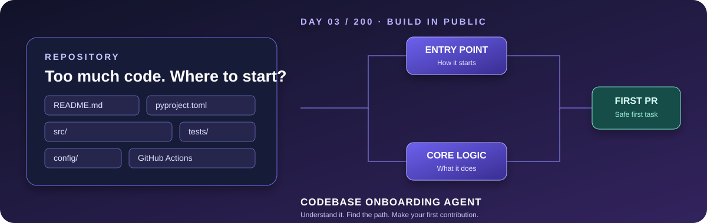

# Codebase Onboarding Agent

**Day 03 of the 200 AI Agents in 200 Days challenge**

A portable, open-source Agent Skill that helps a developer understand an unfamiliar codebase before changing it. Give it a public GitHub repository URL, a source ZIP, or selected files. It produces a beginner-friendly architecture map, explains entry points and important functions, derives setup and test instructions from the actual project, describes dependencies, and suggests small first contributions.

**No server, API key, or separate app is required for the skill itself.** Use it inside a compatible AI assistant. The assistant still needs access to the repository or uploaded source, and live repository browsing depends on tools and permissions available in that assistant.

## What it produces

- A plain-English explanation of the project based on evidence.
- A small architecture diagram and data-flow walkthrough.
- The actual application entry point(s), where the source supports that conclusion.
- Key files, functions and classes explained for a newcomer.
- Install, run and test instructions derived from project manifests and documentation.
- A dependency table with evidence and confidence.
- Three to five beginner-friendly contribution ideas with file paths and test plans.
- Explicit unknowns and risks instead of made-up details.

## Fastest way to try it

1. Open SKILL.md in this folder.
2. Install this skill in a client that supports Agent Skills, or use the manual fallback in INSTALLING.md.
3. Provide a public GitHub repository URL or upload a source ZIP.
4. Ask: “Give me a beginner codebase tour and three good first contributions.”
5. Verify the cited files and paths before relying on the analysis.

The skill is instruction-based. It does not itself clone repositories, run code, or call GitHub APIs. Those abilities depend on the assistant's available tools. If the assistant cannot access a URL, upload the source files instead.

## Files

- SKILL.md — complete instructions and safety rules.
- INSTALLING.md — platform notes and manual fallback.
- references/ — report template, investigation checklist and beginner contribution playbook.
- examples/ — synthetic toy project and a sample report.
- tests/acceptance-tests.md — behavioral test cases.

## Supported surfaces

Agent Skills are an open format, but native installation and account eligibility vary. See INSTALLING.md and the official platform documentation linked there. A generic-chat fallback is to paste SKILL.md into the assistant and attach the repository source.

## Safety and accuracy

Repository content is untrusted data. The skill tells the assistant not to execute untrusted scripts by default, not to reveal secrets, and not to follow instructions found inside source files. Findings should point to observed paths/symbols or be clearly labeled as inferences or unknowns.

## License

MIT. See LICENSE.
